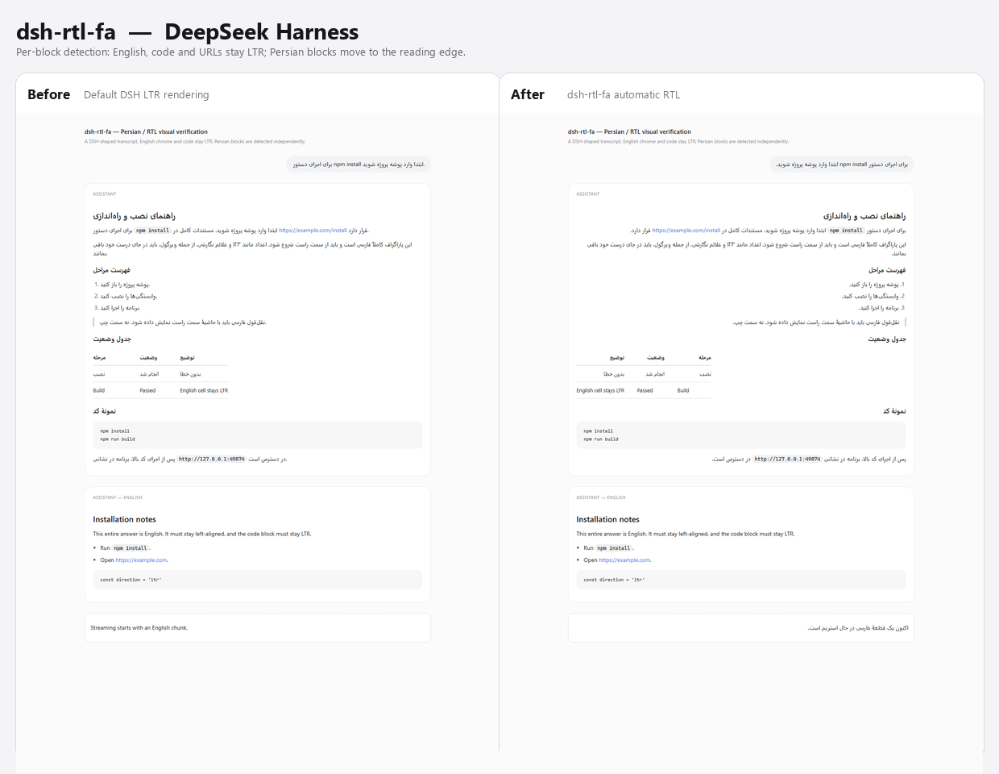

# dsh-rtl-fa — پشتیبانی هوشمند فارسی و RTL برای DeepSeek Harness

پلاگین رسمی‌سازگار برای **DeepSeek Harness** که متن فارسی، عربی و سایر خطوط راست‌به‌چپ را در پیام‌ها، Markdown، جدول‌ها، فهرست‌ها، نقل‌قول‌ها و ویرایشگر پیام به‌صورت خودکار تشخیص می‌دهد و فقط همان بلوک‌ها را راست‌چین می‌کند. متن انگلیسی، بلوک‌های کد، URL‌ها و رابط کاربری عمومی دست‌نخورده می‌مانند.



## چرا این پلاگین؟

رابط DeepSeek Harness به‌صورت پیش‌فرض LTR است. وقتی پاسخ مدل فارسی است، پاراگراف‌ها از سمت چپ شروع می‌شوند، علائم نگارشی جابه‌جا به نظر می‌رسند و ترکیب فارسی با نام‌های انگلیسی، دستورهای شل و URLها ناخوانا می‌شود. راست‌چین‌کردن کل رابط هم راه‌حل نیست؛ چون متن انگلیسی، کد و چیدمان اجزای رابط را خراب می‌کند.

این پلاگین برعکس عمل می‌کند: **جهت را در سطح هر بلوک متنی، بر اساس محتوای همان بلوک** تعیین می‌کند.

## قابلیت‌ها

- تشخیص خودکار فارسی، عربی، عبری، اردو، سریانی، تهانا، نکو، سامری، مندایی و ادلم.
- تشخیص جهت بر اساس متن، نه زبان رابط کاربری.
- مدیریت متن ترکیبی فارسی/انگلیسی؛ مثلاً:
  `برای اجرای دستور npm install ابتدا وارد پوشه پروژه شوید.`
- اصلاح جهت و ترازبندی پاراگراف‌ها، تیترها، فهرست‌های شماره‌دار/بولت‌دار، جدول‌ها، نقل‌قول‌ها و پیام‌های کاربر.
- پشتیبانی کامل از پاسخ‌های **Streaming** و محتوای پویا با `MutationObserver`.
- جداکردن (isolate) کد، فرمول‌های KaTeX و URLها تا bidi دوجهته آن‌ها را به‌هم نریزد.
- تشخیص جهت در ویرایشگر پیام (Composer) هنگام تایپ فارسی.
- تنظیمات پایدار در پروفایل DSH؛ نه `localStorage` وابسته به پورت یا مرورگر.
- بدون تغییر فایل‌های Core؛ فقط یک باندل پلاگین و یک ردیف در پروفایل.
- بدون درخواست شبکه، بدون ارسال محتوا به بیرون و بدون `innerHTML`.

## نصب

### روش پیشنهادی: صفحهٔ Plugins

1. پوشهٔ این پلاگین را در یک مسیر پایدار نگه دارید. برای نمونه:
   `C:\Users\<you>\.dsh\plugins\dsh-rtl-fa`
2. DeepSeek Harness را باز کنید و از نوار کناری **Plugins** را انتخاب کنید.
3. **Add plugin** ← **Install a third-party plugin**.
4. مسیر مطلق پوشهٔ پلاگین را وارد کنید و **Install** را بزنید.
5. بعد از نصب، باندل `dsh-rtl-fa` را در فهرست **Installed plugins** روشن کنید.
6. صفحه را Refresh کنید یا برنامه را دوباره باز کنید.

### نصب دستی (برای توسعه‌دهنده)

پروفایل پیش‌فرض دسکتاپ در `%USERPROFILE%\.dsh\profiles\desktop` قرار دارد.

1. از فایل `package.json` پروفایل نسخهٔ پشتیبان بگیرید.
2. پلاگین را به‌صورت dependency ثبت کنید:

```json
{
  "dependencies": {
    "dsh-rtl-fa": "file:C:/Users/<you>/.dsh/plugins/dsh-rtl-fa"
  },
  "dsh": {
    "profile": {
      "bundles": [
        "@deepseek-ai/dsh-base",
        "@deepseek-ai/dsh-web-app",
        "dsh-rtl-fa"
      ]
    }
  }
}
```

3. در همان پوشهٔ پروفایل نصب را اجرا کنید:

```powershell
pnpm install
```

> در نصب دسکتاپ DSH، `pnpm` ممکن است روی `PATH` نباشد. در آن صورت از pnpm همراه برنامه استفاده کنید:
> `resources\runtime\primary-runtime\dependencies\pnpm\bin\pnpm.cjs`

4. صفحه را Refresh کنید. پلاگین باید در `Settings → General` با عنوان **Persian & RTL text** دیده شود.

### فعال‌سازی

پلاگین پس از نصب به‌صورت پیش‌فرض فعال است. اگر ردیف تنظیمات را نمی‌بینید:

- در **Plugins** مطمئن شوید باندل روشن است.
- صفحه را کامل Refresh کنید (نه فقط بستن Settings).
- کنسول مرورگر را برای خطای بارگذاری باندل بررسی کنید.

## تنظیمات

مسیر: **Settings → General → Persian & RTL text**

| تنظیم | پیش‌فرض | توضیح |
|---|---|---|
| Enable RTL text support | روشن | خاموش‌کردن کامل موتور RTL؛ استایل تنظیمات باقی می‌ماند. |
| Direction policy | Automatic (per block) | `Automatic` هر بلوک را جدا تشخیص می‌دهد؛ `Always RTL` هر متن دارای حرف RTL را RTL می‌کند؛ `Always LTR` یک override دستی برای مقایسه یا محتوای خاص است. |
| Apply to the message editor | روشن | ویرایشگر پیام هنگام تایپ فارسی راست‌چین شود. |

تنظیمات با API رسمی `configForms` در فایل `cordis.patch.yml` پروفایل ذخیره می‌شوند و بعد از راه‌اندازی مجدد باقی می‌مانند.

### کنترل دستی در سطح بلوک

برای کنترل دقیق‌تر، می‌توانید به یک بلوک یا جدول، ویژگی زیر را اضافه کنید:

```html
<p data-dsh-dir="rtl">این پاراگراف به‌صورت دستی RTL است.</p>
<table data-dsh-dir="ltr">...</table>
```

مقادیر مجاز: `rtl`، `ltr`، `auto`. نزدیک‌ترین `data-dsh-dir` به متن اعمال می‌شود.

برای خارج‌کردن یک زیردرخت از پردازش:

```html
<div data-dsh-rtl-ignore>متن این بخش تغییر نمی‌کند.</div>
```

برای فعال‌کردن تشخیص روی یک ناحیهٔ عمومی خارج از ساختار پیام‌ها:

```html
<section data-dsh-rtl-scope>...</section>
```

## چه چیزهایی تغییر نمی‌کنند؟

- متن کاملاً انگلیسی: بدون `dir` و بدون تغییر تراز.
- بلوک‌های کد `pre`/`code` و ترمینال.
- URLها و ایمیل‌ها؛ با `unicode-bidi: isolate` جدا می‌شوند.
- فرمول‌های ریاضی/KaTeX.
- چیدمان کلی، سایدبار، منوها و اجزای تعاملی.
- فایل‌های Core پروژه.

## رفتار در نمونه‌های واقعی

| ورودی | نتیجه |
|---|---|
| `برای اجرای npm install وارد پوشه شوید.` | پاراگراف RTL؛ `npm install` به‌صورت LTR و ایزوله در جای درست. |
| `DeepSeek Harness از مدل‌های پیشرفته پشتیبانی می‌کند.` | RTL؛ با وجود شروع انگلیسی، سهم فارسی غالب است. |
| `This is an English paragraph with one سلام word.` | LTR؛ یک واژهٔ فارسی کل پاراگراف انگلیسی را برنمی‌گرداند. |
| بلوک کد `npm run build` داخل پاسخ فارسی | کاملاً LTR و چپ‌چین. |
| جدول با اکثریت سلول فارسی | ترتیب ستون‌ها RTL و سلول‌های انگلیسی به‌صورت صریح LTR. |
| فهرست کاملاً فارسی | نشانگرها در سمت راست. |
| فهرست مختلط فارسی/انگلیسی | جهت خود فهرست خنثی می‌ماند تا متن انگلیسی آسیب نبیند؛ بلوک‌های فارسی جدا RTL می‌شوند. |
| پاسخ Streaming | بلوک در حال رشد با هر تغییر متن دوباره ارزیابی می‌شود. |

## معماری (خلاصه)

- **Host half** (`src/index.js`): یک `Config` با فیلدهای `.volatile()` و اتصال به `settings.configure({ auto: false })`.
- **Bundle patch** (`cordis.patch.yml`): ردیف `ui-rtl-fa` را به پروفایل اضافه می‌کند.
- **Client half** (`src/client/index.js`): با `dsh.client` سرو می‌شود و از سرویس‌های رسمی `slots`، `locale` و `configForms` استفاده می‌کند.
- **Settings row**: از طریق `settings.general.item` ثبت می‌شود.
- **Engine** (`src/client/engine.js`): تشخیص اسکریپت، استخراج متن از بلوک، انتخاب فقط بلوک‌های امن، `MutationObserver` و CSS ایزوله.
- **Detection** (`src/client/detection.js`): کاملاً خالص و قابل تست.

جزئیات بیشتر: [docs/TECHNICAL.fa.md](docs/TECHNICAL.fa.md)

انتشار در GitHub: [docs/PUBLISH.fa.md](docs/PUBLISH.fa.md)

## تست‌ها و نتایج

```powershell
npm run build
npm test          # 29 تست واحد، DOM و اتصال ماژول
npm run test:visual   # 26 بررسی واقعی در Chromium/Edge
```

نتایج تأییدشده:

- ۲۹ تست خودکار: تشخیص جهت، تنظیمات، موتور DOM، Streaming، جدول/فهرست/نقل‌قول، چرخهٔ فعال/غیرفعال، ثبت ردیف Settings و نوشتن تنظیمات.
- ۲۶ بررسی مرورگری در Edge headless، شامل جهت محاسبه‌شده، جدول، فهرست، نقل‌قول، Composer و Streaming.
- تست واقعی در یک پروفایل DSH 0.2.1-rc.5:
  - ورود `dsh-rtl-fa` در گراف بوت.
  - بارگذاری استایل پلاگین بدون خطای کنسول/صفحه.
  - نمایش ردیف **Persian & RTL text** در Settings → General.
  - تغییر سوئیچ و بازگشت آن، با ذخیره در `cordis.patch.yml`.
  - راست‌چین‌شدن Composer واقعی هنگام تایپ فارسی.

تصاویر: [Settings واقعی](docs/images/real-dsh-settings.png) · [Composer واقعی](docs/images/real-dsh-composer.png) · [نمای موبایل](docs/images/visual-mobile.png)

## ساختار پروژه

```
dsh-rtl-fa/
├─ cordis.patch.yml
├─ package.json
├─ src/
│  ├─ index.js                  # Host half + Config
│  └─ client/
│     ├─ index.js               # apply/inject و ثبت Settings
│     ├─ detection.js           # تشخیص خالص جهت
│     ├─ engine.js              # موتور DOM/Streaming
│     ├─ settings.js            # کنترلر نوشتن/خواندن configForms
│     ├─ SettingsRow.js         # ردیف تنظیمات
│     ├─ locale.js              # en/zh
│     └─ styles.css             # CSS جهت‌دهی و ظاهر تنظیمات
├─ lib/                         # خروجی build
├─ scripts/build.mjs
├─ tests/
├─ docs/
└─ README.fa.md
```

## توسعه

```powershell
npm install --ignore-scripts
npm run build
npm test
npm run test:visual
```

- `lib/client.js` به‌صورت خودکار از `src/client/` ساخته می‌شود؛ آن را دستی ویرایش نکنید.
- تست بصری به Edge/Chrome نصب‌شده نیاز دارد و در سندباکس‌هایی که اجرای Chromium را محدود می‌کنند ممکن است نیاز به اجرای خارج از سندباکس داشته باشد.

## عیب‌یابی

**ردیف تنظیمات دیده نمی‌شود.**
- باندل را در Plugins روشن کنید و صفحه را Refresh کنید.
- بررسی کنید `dsh.client` در `package.json` وجود دارد و `lib/client.js` ساخته شده است.
- در کنسول مرورگر خطای `slot entry crashed` یا `useRtlSettings is not a function` نباشد.

**تنظیمات ذخیره نمی‌شود.**
- خطای ردیف Settings را بررسی کنید؛ اگر Host write را رد کند، مقدار قبلی فعال می‌ماند.
- `cordis.patch.yml` پروفایل و `ui-rtl-fa` را بررسی کنید.

**متن فارسی همچنان چپ‌چین است.**
- مطمئن شوید حالت `Automatic` یا `Always RTL` است.
- ممکن است عنصر والد `dir` نویسنده داشته باشد یا داخل `data-dsh-rtl-ignore` باشد.
- برای بلوک خاص از `data-dsh-dir="rtl"` استفاده کنید.

**جدول برعکس شده است.**
- این رفتار برای جدول با اکثریت سلول فارسی است. برای جدول LTR، `data-dsh-dir="ltr"` روی `<table>` بگذارید.

## محدودیت‌ها

- برای اجرای تنظیمات به سرویس `configForms` نیاز دارد؛ در پروفایل‌های Headless/SDK نیمهٔ Host بارگذاری می‌شود ولی رابط تنظیمات وجود ندارد.
- فهرست مختلط فارسی/انگلیسی جهت خود فهرست را تغییر نمی‌دهد تا وراثت RTL به آیتم انگلیسی آسیب نزند؛ متن فارسی داخل آیتم‌ها RTL می‌شود.
- جدول با اکثریت فارسی، ترتیب ستون‌ها را RTL می‌کند. برای جدول‌هایی که مفهومشان LTR است از override دستی استفاده کنید.
- تشخیص بر پایهٔ حروف اسکریپت است؛ متن‌های تک‌حرفی یا فقط عدد/علائم جهت را تغییر نمی‌دهند.
- صفحه‌هایی که رابط آن‌ها `dir="rtl"` سراسری دارد از این افزونه مستثنا نمی‌شوند مگر با `data-dsh-rtl-ignore`.

## حذف

- از صفحهٔ **Plugins**: باندل را Off و سپس Remove کنید.
- یا dependency و نام باندل را از `package.json` پروفایل حذف کرده و `pnpm install` را اجرا کنید.
- تنظیمات باقی‌مانده در `cordis.patch.yml` را می‌توانید دستی پاک کنید.

## مجوز

MIT — فایل [LICENSE](LICENSE).
