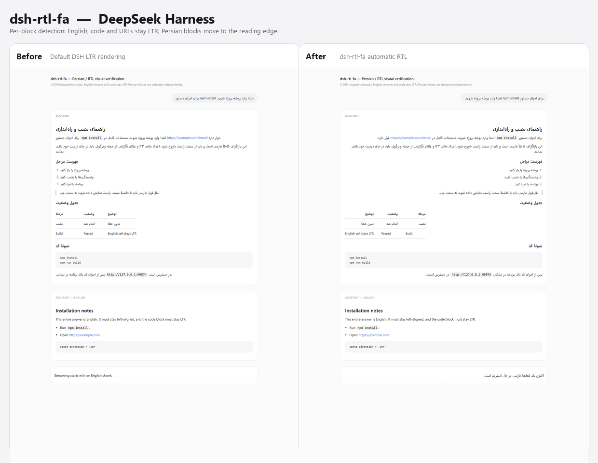

# dsh-rtl-fa

Intelligent Persian, Arabic and RTL text layout for the **DeepSeek Harness** Web GUI.

[فارسی](README.fa.md) · [Technical reference](docs/TECHNICAL.fa.md)



## What it does

DSH renders conversation Markdown left-to-right. A Persian answer therefore starts at the wrong edge and mixed Persian/English/URL/code paragraphs become hard to read. Flipping the entire UI to RTL is not a fix: it breaks English prose, code, tables, and component layout.

This plugin decides direction **per text block, from that block's own content**:

- detects Arabic-script (Persian, Arabic, Urdu, …) and other RTL scripts (Hebrew, Syriac, Thaana, N'Ko, Samaritan, Mandaic, Adlam);
- right-aligns paragraphs, headings, list items, quotes, table cells, user bubbles, and the message editor when the content is RTL;
- keeps English-only blocks, code fences, inline code, URLs, e-mail addresses, KaTeX, and UI chrome untouched;
- updates streamed answers and dynamically inserted content through one coalesced `MutationObserver` batch;
- persists settings in the DSH profile through the official `configForms` service, not origin-scoped `localStorage`;
- installs as a normal profile bundle with no Core file edits.

## Install

### Plugins page (recommended)

1. Keep this folder at a stable path, for example `C:\Users\<you>\.dsh\plugins\dsh-rtl-fa`.
2. Open **Plugins → Add plugin → Install a third-party plugin**.
3. Enter the absolute folder path and install.
4. Enable the `dsh-rtl-fa` bundle in **Installed plugins**.
5. Refresh the page (or restart DSH).

### Manual profile install

In `%USERPROFILE%\.dsh\profiles\desktop` (back up `package.json` first):

```json
{
  "dependencies": {
    "dsh-rtl-fa": "file:C:/Users/<you>/.dsh/plugins/dsh-rtl-fa"
  },
  "dsh": {
    "profile": {
      "bundles": [
        "@deepseek-ai/dsh-base",
        "@deepseek-ai/dsh-web-app",
        "dsh-rtl-fa"
      ]
    }
  }
}
```

Then `pnpm install` in that profile and refresh the page.

## Settings

**Settings → General → Persian & RTL text**

| Setting | Default | Meaning |
|---|---|---|
| Enable RTL text support | on | Master switch. The stylesheet stays loaded so the row keeps its styling. |
| Direction policy | Automatic (per block) | Automatic detection; Always RTL for any RTL-script block; Always LTR as a manual override. |
| Apply to the message editor | on | Right-align the composer while the draft contains RTL text. |

Settings are written to the active profile's `cordis.patch.yml` and survive restarts.

### Per-block escape hatches

```html
<p data-dsh-dir="rtl">Force this block RTL.</p>
<p data-dsh-dir="ltr">Force this block LTR.</p>
<table data-dsh-dir="ltr">…</table>
<div data-dsh-rtl-ignore>Never touch this subtree.</div>
<section data-dsh-rtl-scope>Opt generic div text into detection.</section>
```

## Mixed-content behavior

| Input | Result |
|---|---|
| `برای اجرای npm install وارد پوشه شوید.` | RTL paragraph; `npm install` stays an isolated LTR run. |
| `DeepSeek Harness از مدل‌های پیشرفته پشتیبانی می‌کند.` | RTL despite the English start; Persian is dominant. |
| `This is English with one سلام word.` | LTR; one foreign word does not flip an English paragraph. |
| Fenced/inline code | Always LTR and isolated. |
| Predominantly Persian table | RTL column order; English cells are explicitly reset to LTR. |
| All-Persian list | Markers move to the right. |
| Mixed list | List direction stays neutral; individual RTL blocks still align right. |
| Streaming answer | Each changed block is re-evaluated on mutation. |

## Tests

```powershell
npm run build
npm test            # 29 unit, DOM, and module-integration tests
npm run test:visual # 26 assertions in real Chromium/Edge
```

Validated in an isolated DSH 0.2.1-rc.5 profile:

- `dsh-rtl-fa` appears in the browser boot graph;
- the plugin stylesheet loads with no console/page errors;
- the Settings row appears under General;
- toggling the switch persists through `cordis.patch.yml`;
- the real Lexical composer receives `dir="rtl"` while typing Persian.

See [docs/TECHNICAL.fa.md](docs/TECHNICAL.fa.md) for the architecture, algorithm, and full test matrix. Publishing instructions are in [docs/PUBLISH.fa.md](docs/PUBLISH.fa.md).

## Project layout

```
src/index.js                 Host half + volatile Config
src/client/index.js          apply/inject, Settings registration
src/client/detection.js      pure script/direction classification
src/client/engine.js         DOM selection, mutation scheduling, reversibility
src/client/settings.js       serialized configForms writes
src/client/SettingsRow.js    feature-owned Settings row
src/client/styles.css        scoped direction and row styling
lib/                         generated host/client artifacts
tests/                       unit, jsdom, module, real-Chromium checks
docs/                        technical notes and screenshots
```

## Development

```powershell
npm install --ignore-scripts
npm run build
npm test
npm run test:visual
```

Do not edit `lib/client.js` by hand. Visual tests need an installed Edge/Chrome and may require running outside a restrictive sandbox that blocks Chromium process/Pipe creation.

## Limitations

- Settings require the `configForms` service; the Host half still loads in headless/SDK profiles, but there is no settings UI there.
- Mixed Persian/English lists keep the list's original direction to prevent RTL inheritance into English items. All-RTL lists move their markers correctly.
- A majority-Persian table reverses column order. For a semantically LTR table, use `data-dsh-dir="ltr"` on the `<table>`.
- Script-based detection ignores numbers, punctuation, and single neutral characters by design.
- Content inside `data-dsh-rtl-ignore` is never changed.

## License

MIT — see [LICENSE](LICENSE).
